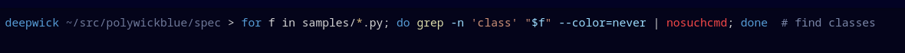

# Deepwick for zsh-syntax-highlighting

Deepwick colors for
[zsh-syntax-highlighting](https://github.com/zsh-users/zsh-syntax-highlighting).

> Deepwick is an unofficial theme derived from
> [Polywick Blue](https://vscode.polywickstudio.net) by Polywick Studio (MIT).
> Not affiliated with Polywick Studio.



## Install

In `~/.zshrc`, source this file **after** zsh-syntax-highlighting:

```zsh
source /path/to/zsh-syntax-highlighting/zsh-syntax-highlighting.zsh
source /path/to/deepwick.zsh
```

Comments are highlighted only with `setopt interactivecomments`. Hex colors
need a true-color terminal (`COLORTERM=truecolor`).

## Notes

- zsh `region_highlight` has no italic, so comments are not italic.
- Commands, functions, and aliases are Yellow; builtins and reserved words
  (`if`, `for`) are Blue; unknown commands are Red; paths are underlined.

Tested with zsh 5.9 and zsh-syntax-highlighting 0.8.0.

## License

MIT. See [LICENSE](LICENSE).
